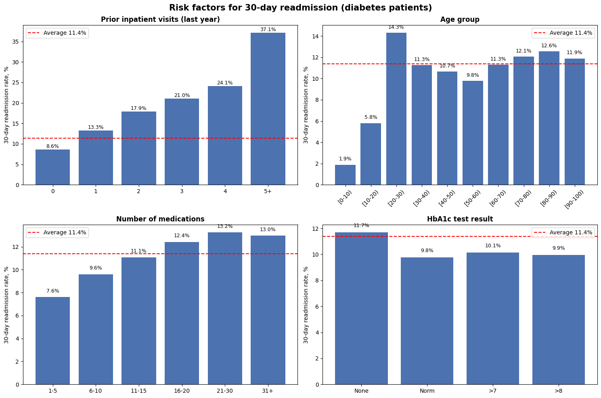
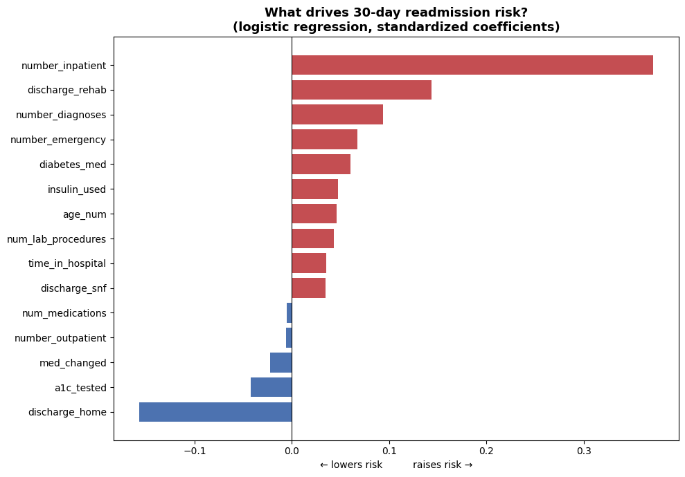

# 🏥 Hospital Readmission Risk Analysis — Diabetes Patients

**Which diabetes patients return to the hospital within 30 days — and how can hospitals and insurers spot them early?**

Analysis of ~100,000 hospital encounters from 130 US hospitals (1999–2008) using SQL (BigQuery), with Python modelling and a Tableau dashboard to follow.

> 🔄 **Status:** SQL analysis ✅ · Python EDA + risk model ✅ · Tableau dashboard planned

---

## 💼 Business Context

30-day readmissions are a key quality indicator and a major cost driver:
- **Hospitals** — readmissions signal gaps in discharge planning; in the US they trigger financial penalties (HRRP), in Germany readmissions within the same DRG case are often not reimbursed separately.
- **Insurers** — a small group of patients generates a large share of costs; early identification enables targeted follow-up programs.
- **Private practices** — responsible for post-discharge follow-up and need to know which patients to see first.

## 📊 Dataset

[Diabetes 130-US Hospitals for Years 1999–2008](https://archive.ics.uci.edu/dataset/296) — UCI Machine Learning Repository (open data, de-identified).

| | |
|---|---|
| Raw encounters | 101,766 |
| Unique patients | 71,518 |
| Features | 50 (demographics, diagnoses ICD-9, lab tests, medications, admission/discharge info) |
| Target | `readmitted` → `<30`, `>30`, `NO` |

## 🛠️ Tools

- **SQL / Google BigQuery** — data loading, quality checks, cleaning, risk-factor analysis
- **Python / Google Colab** (pandas, matplotlib, scikit-learn) — EDA & logistic regression risk model
- **Tableau** — risk monitoring dashboard *(planned)*

---

## 🧹 Data Cleaning

| Issue | Decision | Rationale |
|---|---|---|
| `weight` 96.9% missing | Column dropped | Cannot be imputed meaningfully |
| `medical_specialty` 49.1%, `payer_code` 39.6%, `race` 2.2% missing (`?`) | Replaced with `'Unknown'` | Dropping rows would lose half the data; "not recorded" can itself carry information |
| `diag_1/2/3` < 1.5% missing | Replaced with `NULL` | Few cases |
| `gender = 'Unknown/Invalid'` | 3 rows removed | Invalid records |
| Patients who **died** (codes 11, 19, 20) or went to **hospice** (13, 14) | 2,423 encounters excluded | **Clinical exclusion:** these patients cannot be readmitted and would bias the "not readmitted" group |
| ICD-9 codes contain letters (`V57`, `E909`) | Diagnoses loaded as `STRING` with explicit schema | BigQuery auto-detect failed on these values |

**Result:** 101,766 − 2,423 − 3 = **99,340 encounters** (validated ✅).
**Target:** `readmitted_30d` = 1 if readmitted within 30 days → baseline rate **11.39%**.

> ⚠️ Class imbalance: a model that always predicts "no readmission" would be 88.6% accurate and useless — handled in the modelling stage.

---

## 🔍 Key Findings



### 1. A quarter of patients causes nearly half of all hospitalizations
76.6% of patients had only one encounter, but the remaining **23.4% account for ~46% of all encounters**.

### 2. Prior hospitalizations are the strongest risk factor
| Inpatient visits in prior year | 0 | 1 | 2 | 3 | 4 | 5+ |
|---|---|---|---|---|---|---|
| 30-day readmission rate | 8.6% | 13.3% | 17.9% | 21.0% | 24.1% | **37.1%** |

- Monotonic increase — patients with 5+ prior visits have a **4.3× higher risk**.
- Patients with ≥1 prior visit are **33% of encounters but 50% of all readmissions**.

💡 *A simple rule — "≥1 hospitalization last year → follow-up call/visit within 7 days of discharge" — covers half of all readmissions using data every hospital already has.*

### 3. Discharge destination reflects severity
- Rehab facility: **27.7%**, another inpatient institution: 20.9%, another hospital: 16.1%
- **Skilled nursing facilities (SNF):** 14.7% — moderate rate, but the largest absolute number (~2,050 readmissions) → key target for **transitions-of-care** programs.

### 4. Polypharmacy increases risk
Readmission rate rises from **7.6%** (1–5 medications) to **13.2%** (21–30), then plateaus.

### 5. Age: unexpected peak among young adults
Risk increases after 50 (9.8% → 12.6%), but the **highest rate is at age 20–30 (14.3%)** — likely linked to type 1 diabetes, ketoacidosis and weaker outpatient follow-up. A non-obvious risk group for insurers.

### 6. HbA1c — a process-quality finding
The HbA1c test was **not performed in 83% of encounters**, and this group has the highest readmission rate (11.7% vs. 9.8–10.2% when tested). Testing signals that diabetes was actively managed during the stay.

### Risk factor summary
| # | Factor | Range of 30-day risk | Strength |
|---|---|---|---|
| 1 | Prior inpatient visits | 8.6% → 37.1% | 🔴 very strong |
| 2 | Discharge destination | ~9% → 27.7% | 🔴 strong |
| 3 | Number of medications | 7.6% → 13.2% | 🟠 moderate |
| 4 | Age | 9.8% → 14.3% (non-linear) | 🟡 moderate |
| 5 | HbA1c tested | 9.8% → 11.7% | 🟡 weak, process-relevant |

*Groups with fewer than ~1,000 encounters should be interpreted with caution.*

---

## 🤖 Readmission Risk Model

**Logistic regression** predicting 30-day readmission from information available at discharge (15 features: prior visits, diagnoses count, medications, length of stay, age, discharge destination, HbA1c tested, insulin, medication changes).

**Methodology**
- **Patient-level train/test split** (`GroupShuffleSplit`, 80/20): the same patient never appears in both sets — prevents leakage from 30k repeat encounters.
- **Class imbalance** handled with `class_weight='balanced'`.
- Features standardized → coefficients are directly comparable.

**Results (test set, 19,773 encounters)**
| Metric | Value |
|---|---|
| ROC AUC | **0.660** |
| Recall (readmitted) | 53.2% |
| Precision (readmitted) | 18.0% |

💡 **Business metric:** the **top 10% highest-risk patients contain 22.5% of all readmissions** — their readmission rate is **25.6% vs. 11.3%** on average (**2.3× lift**). Calling only one in ten patients after discharge reaches almost a quarter of all future readmissions.



**Model insights**
- `number_inpatient` is by far the strongest predictor (coef. 0.37, 2.5× the next one), followed by discharge to rehab and number of diagnoses.
- Discharge **home** and an **HbA1c test** lower the risk.
- **Confounding example:** the number of medications raised risk in the univariate SQL analysis, but its effect is ~0 in the model. More medications mark *sicker* patients (more diagnoses, longer stays, prior admissions) — once severity is accounted for, medications themselves add little. Correlation ≠ causation.

**Limitations:** AUC 0.66 is typical for this dataset — key drivers of readmission (social situation, post-discharge care, lab values after discharge) are not recorded. The model is a screening aid for prioritizing follow-up, not a clinical decision tool. Data is from US hospitals, 1999–2008.

---

## 📁 Repository Structure

```
notebooks/
└── diabetes_readmission_analysis.ipynb   # Python: EDA + risk model (Colab)
images/
├── risk_factors.png
└── feature_importance.png
sql/
├── 01_create_raw_table.sql        # explicit schema for raw data
├── 02_patients_by_encounters.sql  # patients by number of encounters
├── 03_missing_values.sql          # data quality: missing values
├── 04_expired_hospice_check.sql   # clinical exclusion check
├── 05_create_clean_table.sql      # cleaning + target variable
├── 06_check_clean_table.sql       # validation & baseline rate
├── 07_rate_by_age.sql
├── 08_rate_by_prior_inpatient.sql
├── 09_rate_by_a1c.sql
├── 10_rate_by_discharge.sql
└── 11_rate_by_medications.sql
```

## 🔁 Reproduce

1. Download `diabetic_data.csv` from the UCI link above.
2. Create a BigQuery dataset `diabetes_readmission` (location EU).
3. Run `01_create_raw_table.sql`, then upload the CSV into `raw_diabetic_data` (append, skip 1 header row).
4. Run `05_create_clean_table.sql`, then the analysis queries.
5. Open the notebook in Google Colab (link at the top of the notebook) to reproduce the charts and model.

*Note: column names with hyphens (e.g. `glyburide-metformin`) were renamed with underscores.*

---

## 👩‍⚕️ About

**Yuliia Butenko** — Junior Data Analyst with a background in clinical nursing, combining domain knowledge of patient care with SQL, Python and Tableau.

📍 Düsseldorf, Germany · [GitHub](https://github.com/ButenkoYuliia)
